

# 🧻 물티슈 ARCADE

**HTML GAME STATION** — 브라우저에서 바로 즐기는 19개의 아케이드 게임

---

## 소개

레트로 아케이드 감성의 HTML 게임 모음입니다.
슈팅, 생존, 리듬, 채굴, 퍼즐까지 장르별로 19개의 게임이 들어 있고,
런처에서 원하는 게임을 골라 바로 실행할 수 있습니다.

- 사이드바에서 게임 선택 · 이름 검색
- 새로고침 / 새 창 / 전체화면 지원

## 게임 목록

<table>
<tr>
<td width="50%" valign="top">
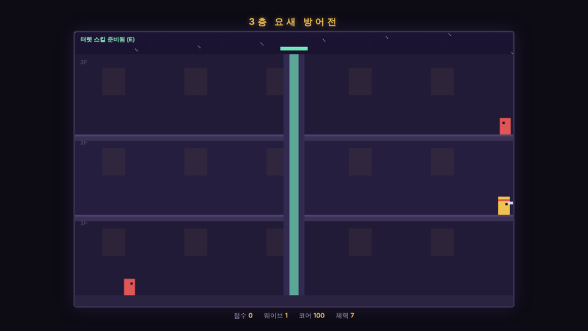 
<b>01 · 3층요새</b> 
3층 구조의 요새를 지키는 디펜스 슈팅
</td>
<td width="50%" valign="top">
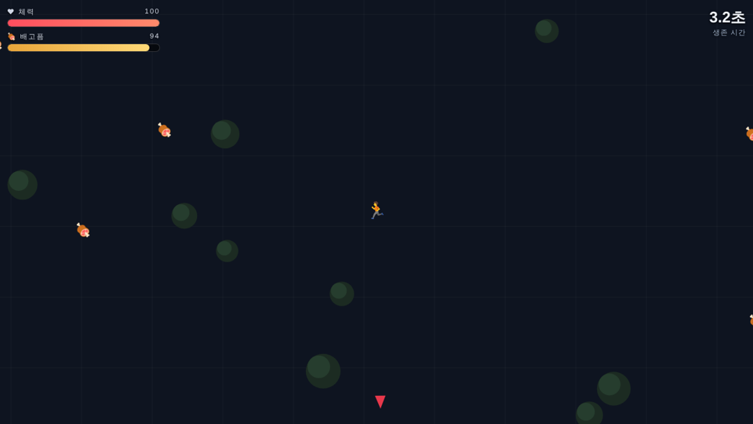 
<b>02 · 괴물탈출 생존게임</b> 
괴물을 피해 탈출구를 찾는 생존 게임
</td>
</tr>
<tr>
<td width="50%" valign="top">
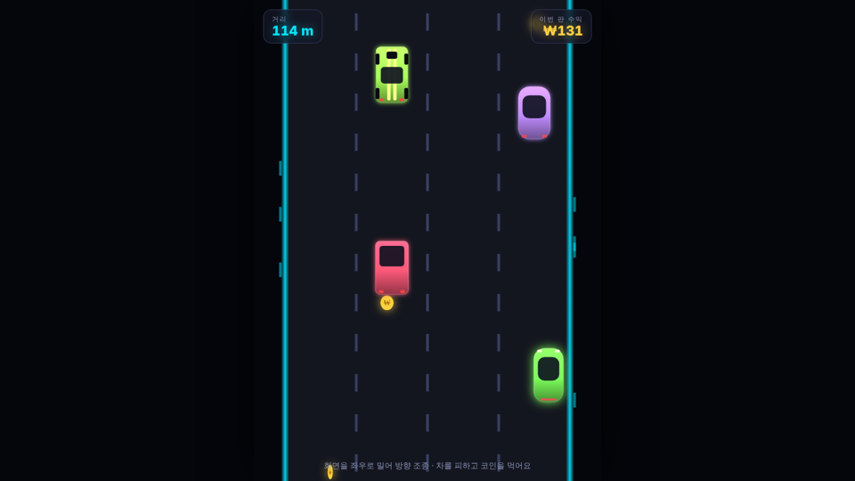 
<b>03 · 머니드라이브</b> 
달릴수록 돈이 쌓이고, 돈이 쌓이면 더 빠른 차가 온다
</td>
<td width="50%" valign="top">
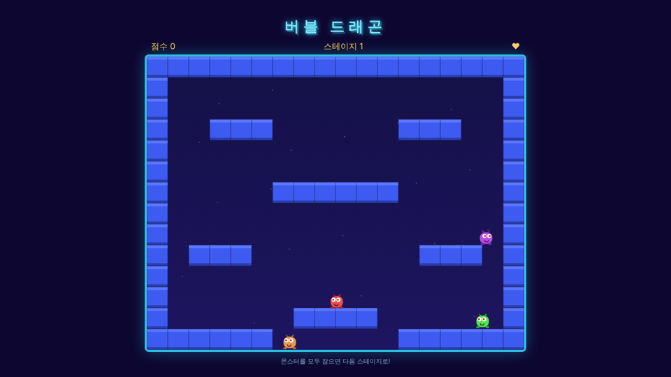 
<b>04 · 버블드래곤</b> 
몬스터를 버블로 가둬 스테이지 클리어
</td>
</tr>
<tr>
<td width="50%" valign="top">
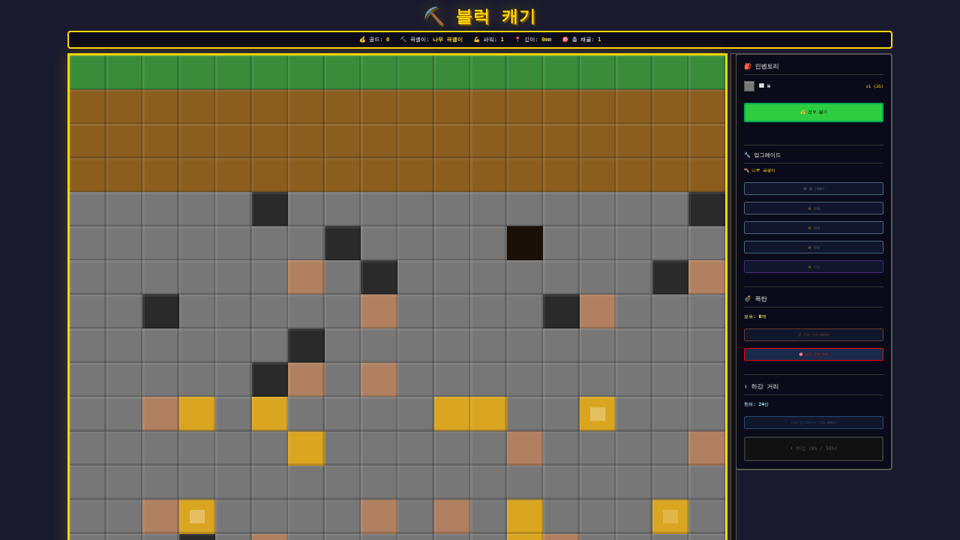 
<b>05 · 블록채굴게임</b> 
블록을 캐서 자원을 모으는 채굴 게임
</td>
<td width="50%" valign="top">
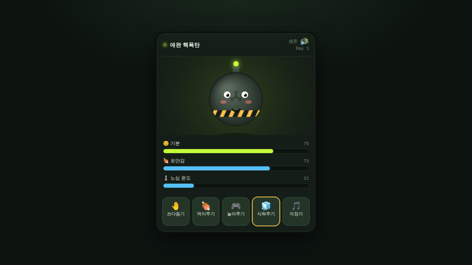 
<b>06 · 애완핵폭판</b> 
핵폭탄을 키우는 다마고치
</td>
</tr>
<tr>
<td width="50%" valign="top">
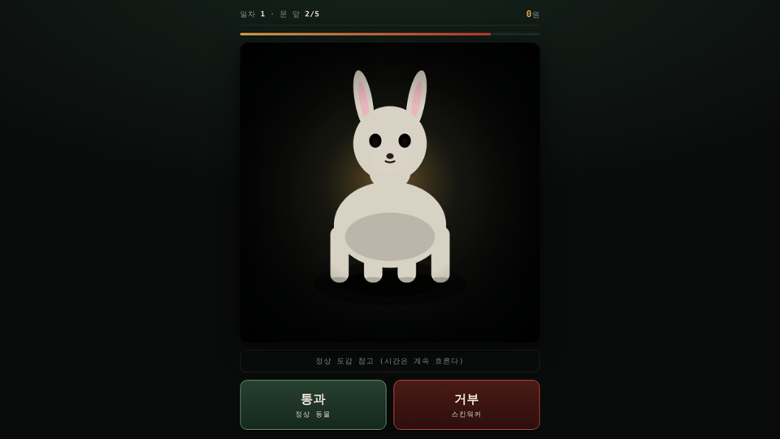 
<b>07 · 야간초소</b> 
야간 경계 근무 호러
</td>
<td width="50%" valign="top">
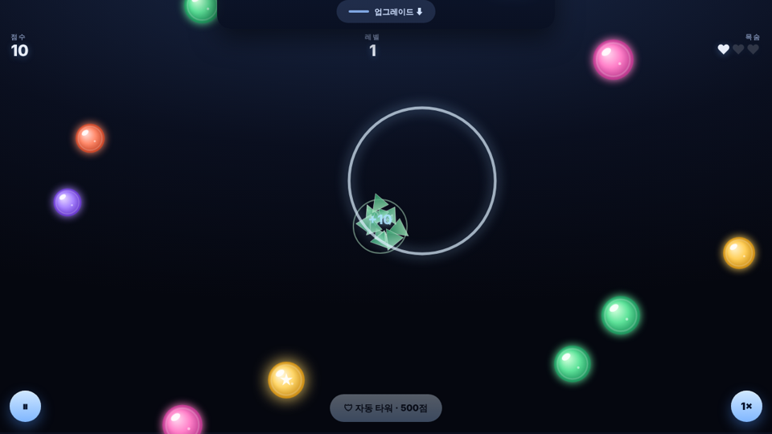 
<b>08 · 유리구슬</b> 
구슬을 깨트리는 아케이드
</td>
</tr>
<tr>
<td width="50%" valign="top">
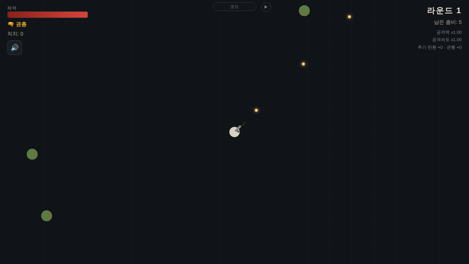 
<b>09 · 좀비서바이벌</b> 
몰려오는 좀비 웨이브를 버티는 생존 게임
</td>
<td width="50%" valign="top">
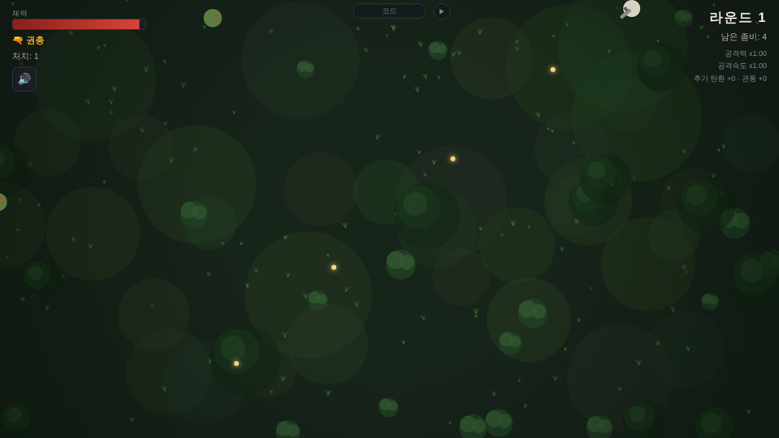 
<b>09-2 · 좀비서바이벌2</b> 
숲 속 배경으로 바뀐 좀비서바이벌 개선판, 관통 총알 판정 개선
</td>
</tr>
<tr>
<td width="50%" valign="top">
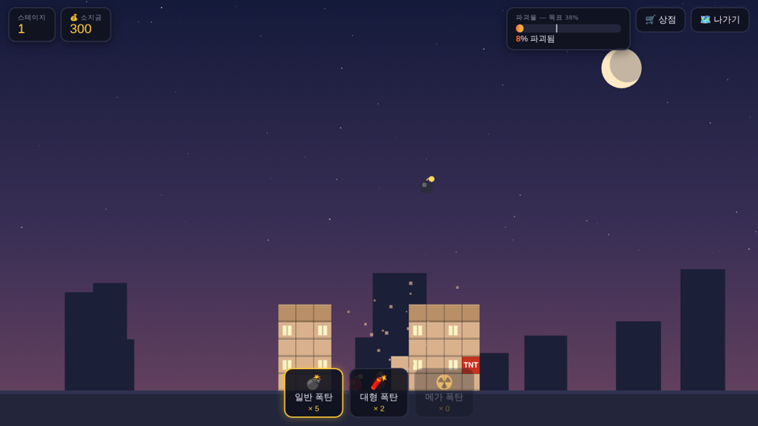 
<b>10 · 폭탄도시파괴</b> 
폭탄으로 도시를 무너뜨리는 물리 게임
</td>
<td width="50%" valign="top">
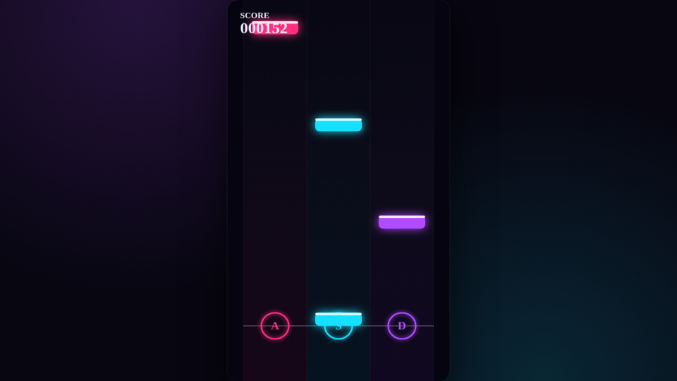 
<b>11 · ASD리듬게임</b> 
A · S · D 세 키로 즐기는 리듬 게임
</td>
</tr>
<tr>
<td width="50%" valign="top">
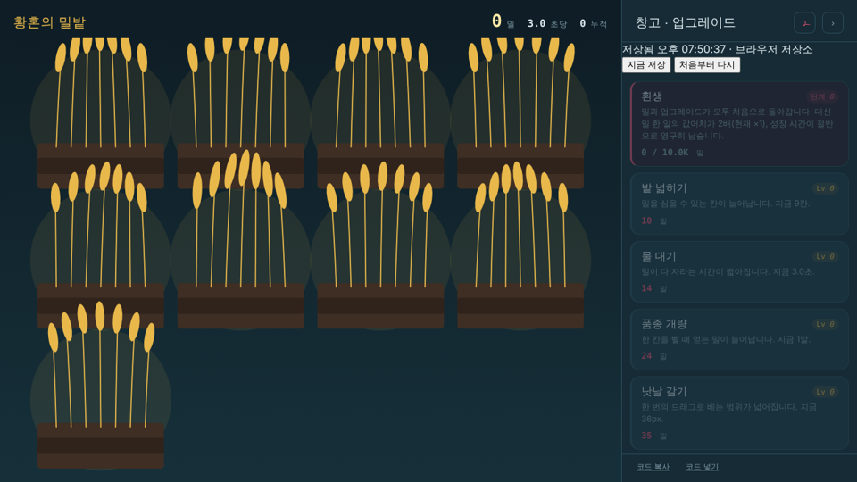 
<b>12 · 황혼의 밀밭</b> 
밀을 베어 모아 밭을 키우는 게임
</td>
<td width="50%" valign="top">
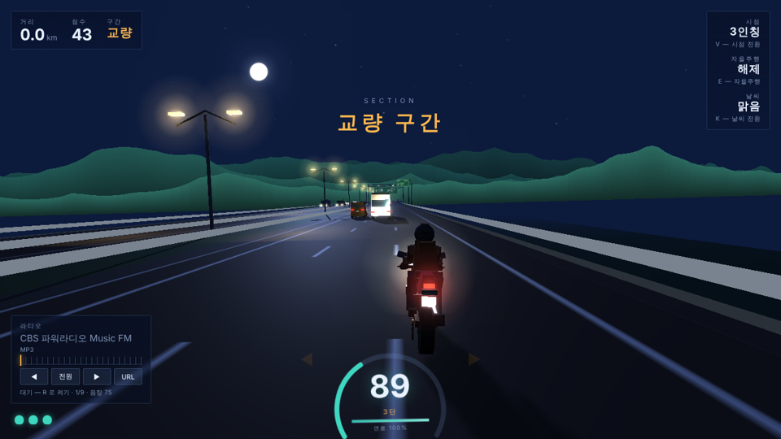 
<b>13 · 나이트라이더</b> 
야간 오토바이 주행 게임, 자동 주행과 라디오 지원, 날씨 및 연료
</td>
</tr>
<tr>
<td width="50%" valign="top">
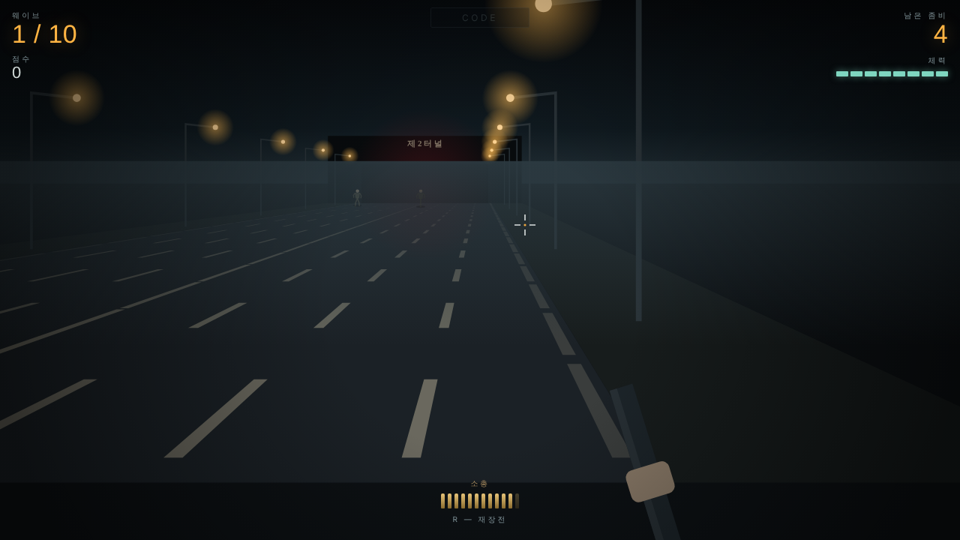 
<b>14 · 8차선방어선</b> 
고속도로에 나타난 좀비 소탕 게임
</td>
<td width="50%" valign="top">
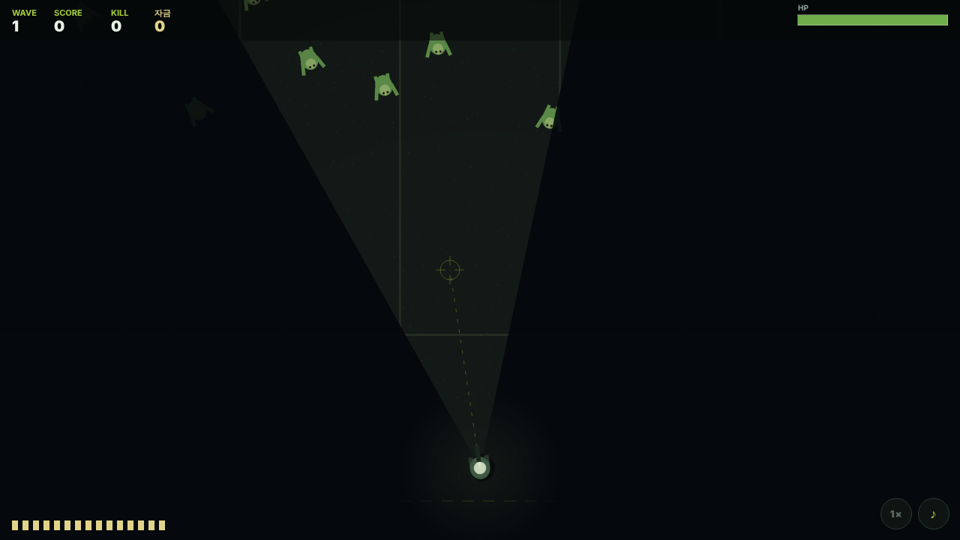 
<b>15 · 야간순찰</b> 
제한된 손전등 시야 속에서 몰려오는 좀비를 소탕하는 게임
</td>
</tr>
<tr>
<td width="50%" valign="top">
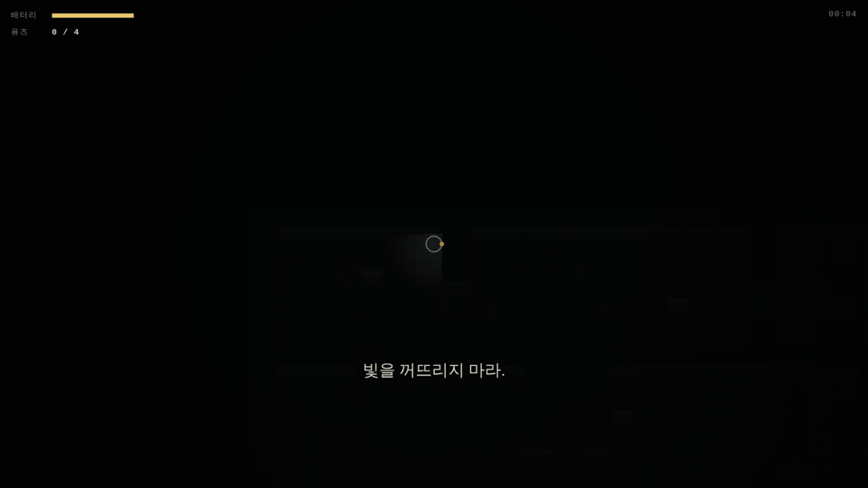 
<b>16 · B4 병동</b> 
병원에서 귀신을 피해 열쇠 획득 후 병원을 탈출하는 게임
</td>
<td width="50%" valign="top">
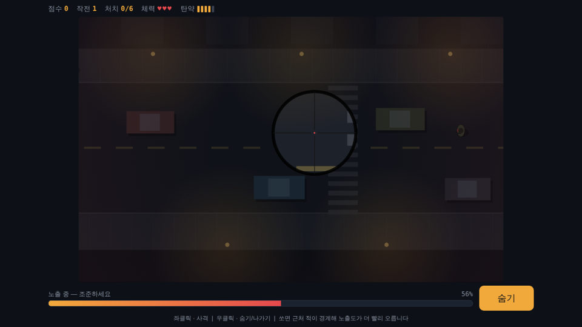 
<b>17 · 옥상 저격수</b> 
옥상에서 저격하는 게임 잘 숨어야한다!
</td>
</tr>
<tr>
<td width="50%" valign="top">
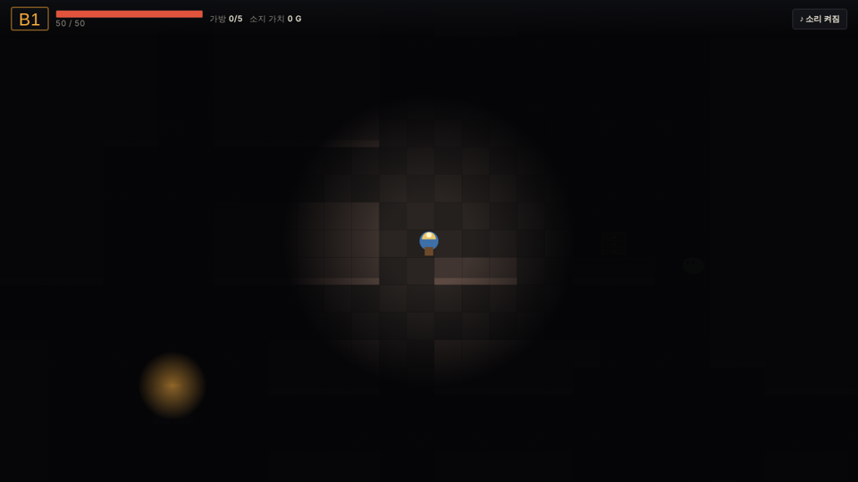 
<b>18 · 지하 수집가</b> 
지하로 내려가 물건을 모아 팔고 강해져서 보스를 쓰러뜨리고 탈출하는 게임
</td>
<td width="50%"></td>
</tr>
</table>
